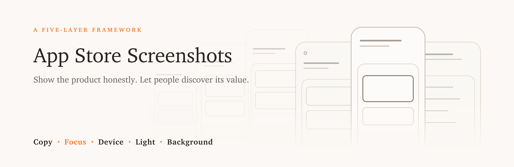
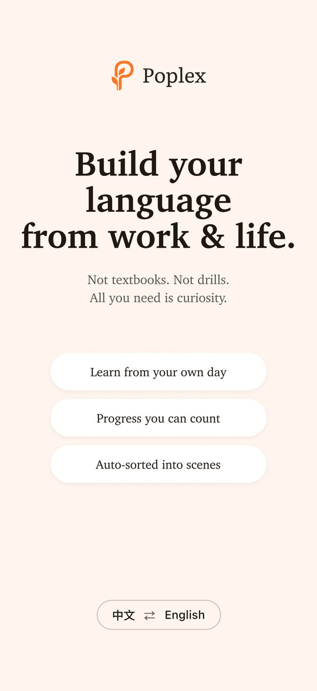
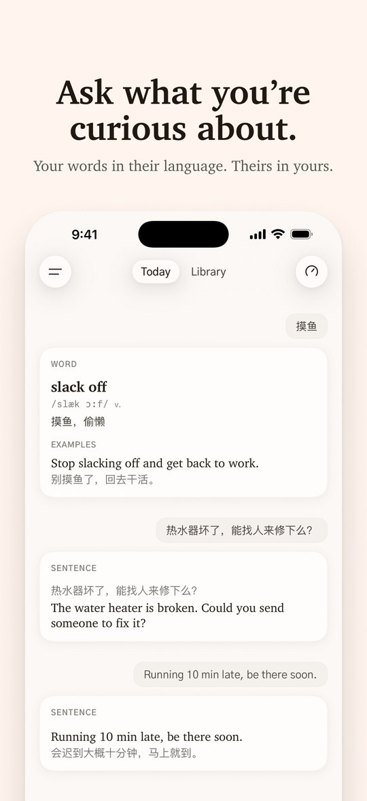
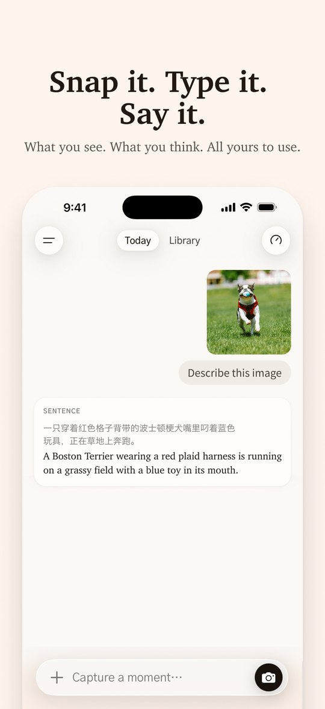
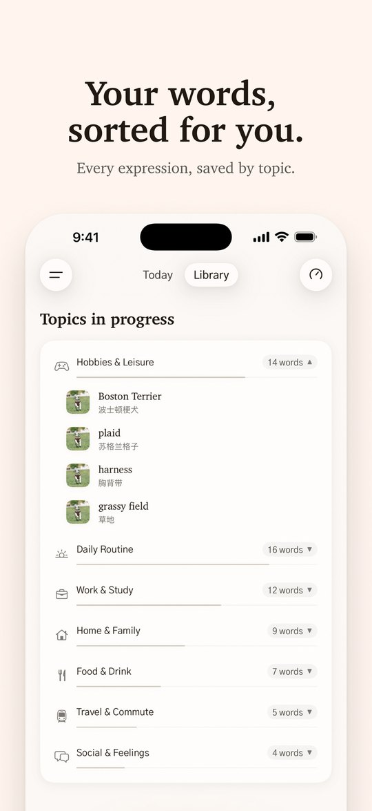
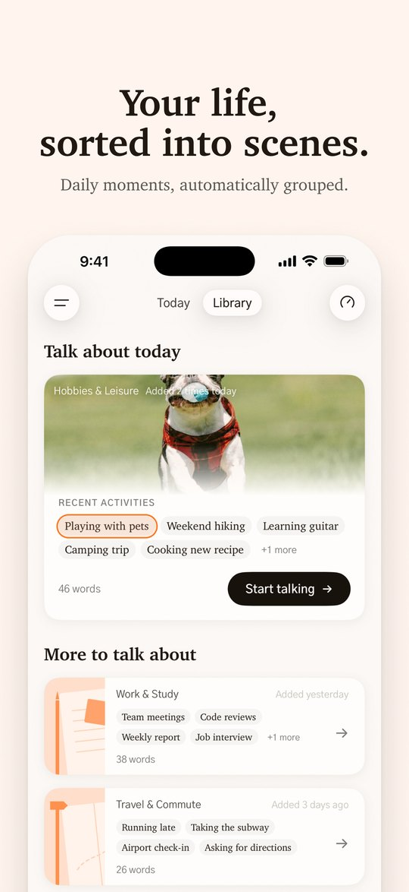

<p align="center">
  
</p>

# App Store Screenshots

A skill for AI agents that helps you design an App Store screenshot set.

**Core principle:** while showing the product honestly, let the user discover what it is worth to them.

[中文说明](docs/README_zh.md)

## How it works

The skill works through five layers: **copy, focus, device, light and shadow, background**. For each layer it proposes two or three options side by side. You pick one, and the choice goes into a spec table that governs the whole set. Then it builds the images, checks them, and exports.

It is deliberately light on rules. For each layer you get the question it answers, a small menu of options with a recommendation, and a short self-check at the end.

## Install

Paste this to your AI agent:

```
Install the skill at https://github.com/LillyLiuJun/app-store-screenshots
into the place where you load skills from, then confirm it is available.
```

Prefer to do it yourself? The skill is a single file, `SKILL.md`. Put it in your agent's skills folder.

## Use it

Ask in plain language. For example:

- "Help me design the App Store screenshots for my app."
- "Revise my screenshots. The first image feels like an ad."
- "Here is a reference screenshot I like. Make it ours."

The skill starts by asking three things: what the product is and the value it gives, what the brand feels like, and what material you already have. A Figma connection is useful, because options are built side by side there, but it is not required.

## Showcase: Poplex

[Poplex](https://github.com/LillyLiuJun/Poplex) 1.0 screenshots, made by **Claude driving Figma through the Figma MCP**.

<table>
  <tr>
    <td></td>
    <td></td>
    <td></td>
    <td></td>
    <td></td>
  </tr>
</table>

## License

MIT, except the images in `assets/`.
